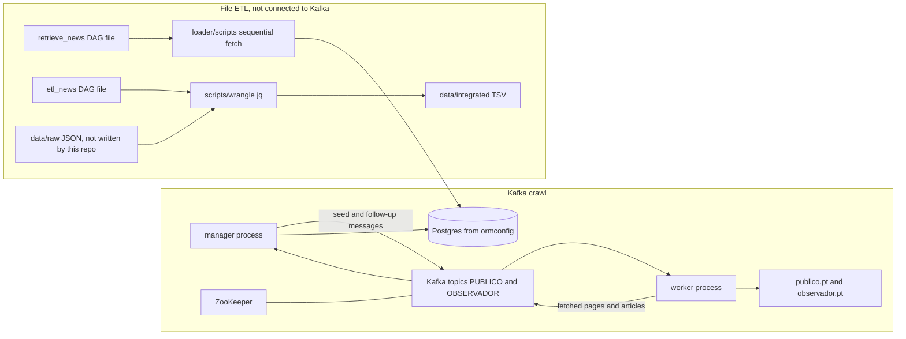

# Media networks and polarisation

This repository collects articles from two Portuguese news outlets, Público and Observador. The name points at a study of media networks and polarisation. The code does not define or compute polarisation. It stops at article text plus the authors, tags, and newspaper name attached to each article.

`data/cache/graphs`, `data/cache/matrices`, and `data/cache/tables` are empty directory markers. Nothing reads or writes them.

## What the pipeline measures

There is no polarisation score, stance label, graph, or distance between outlets. Two separate ingestion paths store articles:

- The Kafka path maps a fetched article into title, date, text, tag names, author names, and a newspaper name (`PUBLICO` or `OBSERVADOR`), then tries to save that through TypeORM.
- The file path maps raw JSON into title, url, text, date, tags, authors, and a newspaper label (`Público` or `Observador`), then writes TSV files.

Those mappings are not the same schema, and neither path builds a network from them.

## Where the source data comes from

The outlets are scraped live over HTTP. There is no checked-in corpus and no archive URL.

Público:

- List pages: `https://www.publico.pt/api/list/ultimas?page=<n>`
- Article HTML: `https://www.publico.pt` plus the article `url`, reading `div.story__body > p`

Observador:

- Newest id: `https://observador.pt/wp-json/obs_api/v4/news/widget`
- Bulk fetch: `POST https://observador.pt/wp-json/obs_api/v4/news/fetchbulk`
- Single item, used by `getArticleData` and not by the Kafka crawl: `https://observador.pt/observador_api/req/3_0/items/id/<id>`

The file ETL reads `$RESEARCH/media_networks_polarisation/data/raw/publico.json` and `observador.json`. No program in this repo writes those files. The Kafka loaders and the sequential `loader/scripts/*.ts` scripts save through TypeORM. They do not fill `data/raw`.

## Architecture

GitHub topics list Airflow and Kafka. Both appear in the tree. They are not one pipeline.

Kafka is what the manager and worker use (`kafkajs` 1.12). ZooKeeper is in the manifests because the Kafka 2.5 image is configured that way. Airflow is two DAG files under `pipelines/`. Nothing in Kubernetes or Skaffold starts Airflow, and the `airflow` directory is gitignored. Those DAG files do something only if an external scheduler loads them.



The manager and the worker both subscribe to both topics, in consumer groups `manager-group` and `worker-group`. Kafka delivers every record to each group. The process looks at the message key and ignores keys meant for the other group. There is no separate work queue and no application-level lease. With the default round-robin assigner, a member claims the partitions the group gives it. The manifests do not set a partition count, and both Deployments set `replicas: 1`.

## Life of a work item

### Kafka crawl

On startup the manager produces two seeds and only then subscribes:

| Topic | Key | Value |
| --- | --- | --- |
| `PUBLICO` | `RETRIEVE_PAGE_OLDEST_ARTICLE` | `"1"` |
| `OBSERVADOR` | `RETRIEVE_MOST_RECENT_ARTICLE` | null |

Público, as the handlers are written:

1. The worker parses the value as a page number, fetches that page's oldest article, and replies with key `RETRIEVED_PAGE_OLDEST_ARTICLE_DATA`.
2. If that reply still has an oldest article, the manager enqueues `RETRIEVE_PAGE` and `RETRIEVE_PAGE_OLDEST_ARTICLE` for the next page. `constants.publico.lastPage` (`69200`) is never read. An empty page omits `pageOldestArticle` from the JSON and the crawl stops.
3. The worker's page handler sends one `PAGE_DATA` message per article object. The manager's `PAGE_DATA` handler parses the value and maps it as an array. A single object does not get that far: the `.map` throws, so no `RETRIEVE_ARTICLE` is produced.
4. When the value is an array, the manager drops titles already stored and enqueues `RETRIEVE_ARTICLE` with the element JSON. The worker runs `parseInt` on that JSON, which is `NaN`, and requests an article URL built from that integer.

Observador:

1. The worker ignores the seed value, calls the widget endpoint, and replies with the newest article under `MOST_RECENT_ARTICLE_DATA`.
2. The manager splits that id with `getArticleIdBatches(id, 1000)` and sends every batch in one produce, key `FILTER_ARTICLES`.
3. `1000` is not a batch size. For id `2500` the batches are `[1, 2]`, `[3, 4, 5]`, `[6, 7]`, and `[8, 9, 10]`. Ids above 10 are not requested. See `openspec/specs/distributed-crawl/spec.md`.
4. The worker POSTs each batch to the bulk endpoint and emits one `FILTERED_ARTICLE_DATA` per returned article.
5. The manager loads rows by title and saves only when that result is falsy. TypeORM `find` returns an array. An array is truthy even when empty, so this save does not run.

`ArticleDTO.toArticle` uses `excludeExtraneousValues: true`. The entity fields are not `@Expose`d, so those properties are dropped before a save. `addUniqueNewspaper` looks up the newspaper named `OBSERVADOR` only. If that row exists, every article, including Público, is pointed at it. If it does not, the article object is passed to the newspaper repository.

Producer calls do not set `acks`, a transactional id, or the idempotent producer. kafkajs 1.12 then uses `acks: -1` and `idempotent: false`.

### File ETL

`pipelines/retrieve_news.py` shells out to `ts-node loader/scripts/publico.ts` and `observador.ts`. Those scripts walk the live sites in-process and call the same save helpers. They do not publish to Kafka.

`pipelines/etl_news.py` runs, in order, `cleanRawData/<outlet>.sh`, `createHeaders.sh`, `joinData.sh`, and `integrateData.sh`, with paths under `$RESEARCH/media_networks_polarisation`.

The clean scripts run jq, then `sed ... file > file`. The shell truncates the file before sed reads it, so `data/clean/<outlet>.json` is empty and the HTML strip never sees the jq output. Join and integrate still do what their jq says when they are given clean JSON by hand: join concatenates every JSON value in `data/clean/*.json`, and integrate writes one TSV per relation. Tags and authors are uniqued by name. Newspaper rows are not.

## Failure handling

Offsets: the application does not set `autoCommit`, `autoCommitInterval`, or `autoCommitThreshold`. In kafkajs 1.12, `commitOffsetsIfNecessary` then does nothing, and the fetch loop commits resolved offsets after the batch. An offset is resolved only after the handler returns.

If the handler throws, earlier offsets in that fetch are committed, the failed offset is not, and the consumer retries the fetch up to the library default of 10 times. When those retries are exhausted the crash path restarts the consumer, because the error is `KafkaJSNumberOfRetriesExceeded`, and the same message is read again. There is no dead-letter topic and no application cap on those restarts. A poison message stalls that partition.

If the process is killed inside a handler, the uncommitted message is delivered again after the group session ends. HTTP calls, follow-up produces, and database writes already done are not rolled back. There is no transaction across Kafka and Postgres, and produced messages have no idempotency key.

Starting the manager again always appends a new page-1 seed and a new Observador seed, including when `manager-group` already has offsets. The Deployment restart policy is the default `Always`, so a container exit runs that startup path again. There is no crawl cursor.

The only retry and timeout numbers declared as application settings are on the Airflow DAG files: `retries: 2`, `retry_delay` of 5 minutes, `sla` of 90 minutes, `dagrun_timeout` of 180 minutes. The shell scripts do not retry. Manager and worker code sets no per-message deadline. Those DAG settings apply only when an external Airflow scheduler loads `pipelines/`.

Unknown keys are ignored and then committed. That is how the other group's messages are skipped. It is also how a key neither group owns disappears.

There is no backpressure. The manager sends the whole Público article list and the whole Observador batch list in one `producer.send`.

## Known gaps

These are absent. The OpenSpec changes under `openspec/changes/` propose them and do not implement them.

| Gap | Where it shows up | Proposal |
| --- | --- | --- |
| No application retry budget, and a failing message is retried forever by consumer restart | KafkaJS default of 10 fetch retries, then restart onto the same offset | `retry-failed-messages` |
| No dead-letter or poison-message handling | No dead-letter topic in code or manifests | `retry-failed-messages` |
| No idempotency key. Redelivery runs the handler again | Produces set no key for dedup. Title is the only lookup | `idempotent-article-writes` |
| Observador rows are not saved | `if (!existingArticles)` is false for every array `find` returns | `idempotent-article-writes` |
| Newspaper is forced to Observador, and transformed fields are dropped on save | `addUniqueNewspaper`, `ArticleDTO.toArticle` | `idempotent-article-writes` |
| A kill mid-handler duplicates side effects, and a manager restart appends new seeds | Offset commit is after the handler. Seeds are unconditional | `crash-safe-crawl-cursor` |
| No backpressure | One `send` for every batch | `bound-crawl-fanout` |
| Público page and article payloads do not match across the two processes | Worker sends one object per article; manager maps an array. Worker `parseInt`s the article JSON | `align-crawl-payloads` |
| Observador id batches drop most ids | `getArticleIdBatches(2500, 1000)` yields only ids 1 through 10 | `cover-observador-id-space` |
| Clean output is erased, and nothing writes `data/raw` | `sed file > file`. No fetch command | `preserve-cleaned-records` |
| No readiness, liveness, or CPU and memory limits. ZooKeeper mounts the broker claim. Kafka and ZooKeeper set `hostPort` | The four Deployments | `workload-health-and-limits` |
| The documented entrypoints do not start the stack | Skaffold paths, Dockerfiles, kustomize, ormconfig, `up.sh` | `runnable-local-and-cluster-stack` |

Also not fixed by those proposals, and not present in the code: `filterArticles` calls `concat` without assigning the result and returns an empty list. No crawl path calls it. The sequential scripts call `getFilteredArticles` directly.

Polarisation is not specified, because the code does not compute one. A future definition would be a new spec, not a description of this tree.

## Running it

Nothing below is a working quick start. The commands in the repo do not match the tree.

### Tests, which do run without a cluster

The pytest suite uses checked-in fixtures of at most a few dozen articles per file. It does not start Kafka or Postgres.

```bash
npm ci --prefix loader
python -m pip install pytest ruff
ruff check tests
pytest -q
```

Golden files cover each wrangle step (`clean` for each outlet, headers, join, integrate) and the pure transforms: Público article mapping, both Observador mappings, id batches, and `range`. The clean goldens are empty because that is what those scripts write.

`openspec validate --all --strict` checks the specs. CI runs the linter, pytest, and that validate.

### Skaffold

`loader/skaffold.yaml` has one profile, `development`. From `loader/` the intended command would be:

```bash
skaffold dev -p development
```

That config builds contexts `manager`, `worker`, and `entities`, and kustomize paths `k8s/overlays/development/secrets` and `k8s/base`. The Dockerfiles and manifests are under `loader/microservices/`, not those paths. There is no `entities` Dockerfile. The development overlay references `kafka.env`, which is not committed (`loader/.gitignore` ignores `**/*.env`).

`loader/deploy.sh` runs `skaffold build -p ci` and `skaffold run -p ci`. The file does not define a `ci` profile.

Both Dockerfiles `COPY package.json yarn.lock` and `CMD ["yarn", "start"]`. The repo has `package-lock.json`, no `yarn.lock`, and `package.json` has no `start` script.

### Kubernetes

`loader/microservices/k8s/infra/up.sh` only creates a GKE cluster named `enterprise-integration` (version `1.16.9-gke.6`, `e2-small`, 3 nodes, zone `europe-west2-a`). It does not apply manifests. `down.sh` deletes that cluster and will prompt.

```bash
kubectl apply -k loader/microservices/k8s/base
```

fails as checked in: the kustomization lists `entities/entities-cluster-ip-service.yaml` and `entities/entities-deployment.yaml`, and those files are not in the repo.

What the manifests do declare, for the pods that are present:

- Manager and worker: one replica each, `KAFKA_HOST=kafka-cluster-ip-service`, `KAFKA_PORT=9092`, no probes, no resource requests or limits, no database environment.
- Kafka `bitnami/kafka:2.5.0` and ZooKeeper `bitnami/zookeeper:3.6.1`, plaintext, `hostPort` 9092 and 2181, no probes, no resource limits.
- ZooKeeper's volume `claimName` is `broker-persistent-volume-claim`, the same ReadWriteOnce claim Kafka uses. `registry-persistent-volume-claim` is unused.
- No Postgres workload. `loader/ormconfig.ts` is Postgres on `localhost` port `3306`, user `test`, password `test`, database `test`, `synchronize: true`, entities glob `entities/*.ts`, which does not match the nested entity files.

## `data/`

Tracked paths under `data/` are `.gitkeep` files so the empty directories stay in git. `.gitignore` ignores `data/**` except directories and those `.gitkeep` files. The only commit on this repo never added article files. `.git` is about 248K. `.gitattributes` marks `*.gz` for Git LFS, and there are no LFS objects.

The raw JSON cannot be re-downloaded from a URL in this repo, and no script regenerates a frozen corpus. Re-running the scrapers hits the live sites and still does not write `data/raw`. Because of that, the `.gitkeep` files stay tracked. There is no fetch script and no DVC remote to add: both would pretend a dataset exists.

If a corpus is added later, put it in Git LFS (the `*.gz` attribute is already there) or in external storage, and keep it out of ordinary git blobs. This change does not rewrite history. A history rewrite would be a force-push, which is a separate decision, and it is not required to drop data that was never committed.

## Repository layout

```
loader/                  TypeScript loader: entities, transforms, Kafka manager and worker
  microservices/         manager, worker, k8s manifests
  scripts/               sequential Público and Observador fetches
  skaffold.yaml          development profile, paths do not match microservices/
  ormconfig.ts           TypeORM Postgres settings
pipelines/               Airflow DAG files etl_news and retrieve_news
scripts/wrangle/         jq clean, header, join, and integrate steps
data/                    empty directory markers only
openspec/                baseline specs of current behaviour, and change proposals
tests/                   fixtures, golden files, pytest
.github/workflows/ci.yml pytest, ruff, openspec validate
```

## Specs

`openspec/config.yaml` holds the project context. Current behaviour is specified under `openspec/specs/`:

- `distributed-crawl` — seeds, consumer groups, payloads, offsets, crashes
- `file-etl` — the DAG files and the jq steps
- `article-transform` — the pure field mappings and `range`
- `cluster-workload` — what the manifests and image build actually declare

`openspec/changes/` holds the proposals in the table above. They are not applied.
